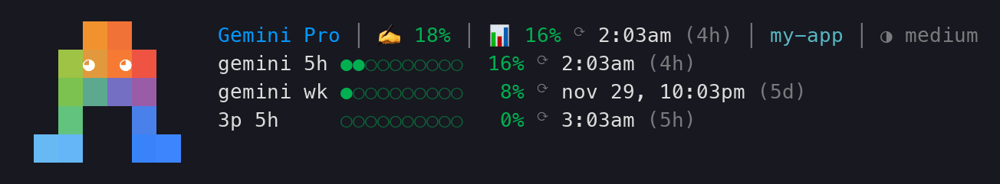

# maggy

[](https://github.com/agy-pet/maggy/releases)

Meet **Maggy** 🌋, an animated pet who lives in your [Antigravity CLI (`agy`)](https://antigravity.google/docs/cli/statusline) statusline. She dances while agy works, next to your model, context usage, quota limits, workspace, git branch and reasoning effort.

**[See her dance →](https://agy-pet.github.io/)**



## Install

```bash
brew install agy-pet/tap/maggy && maggy setup
```

No Homebrew? `curl -fsSL https://agy-pet.github.io/install.sh | bash`

`maggy setup` only sets `statusLine` in `~/.gemini/antigravity-cli/settings.json` and backs up the old file. Needs macOS or Linux, Python 3 and a truecolor terminal.

## Use

```bash
maggy theme list      # themes: default, xmas, halloween, cny, or your own
maggy stats           # what Maggy saw today (maggy stats web for a dashboard)
maggy preview         # watch the animation without running agy
maggy doctor          # something looks off
maggy uninstall --purge
```

Every command, config key, custom theme format and troubleshooting tip is in the **[full guide](GUIDE.md)**. AI agents can read [`llms.txt`](https://agy-pet.github.io/llms.txt).

## License

[MIT](LICENSE). maggy is an unofficial fan project, not affiliated with, endorsed by, or sponsored by Google LLC. Antigravity, Gemini and Google are trademarks of Google LLC.
