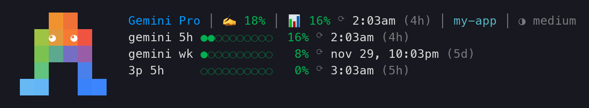
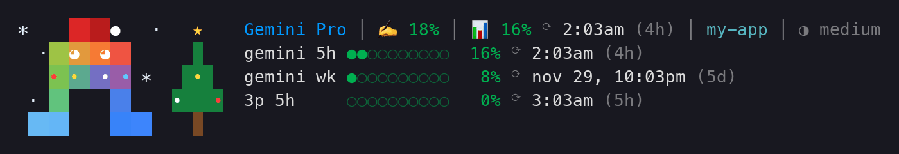

<!-- Maggy 0.8.4 — full docs for AI agents and LLMs. Index: https://agy-pet.github.io/llms.txt · Source: https://github.com/agy-pet/maggy -->

# maggy

[](https://github.com/agy-pet/maggy/releases)

Meet **Maggy** 🌋, an animated **agy pet** who lives in your Antigravity CLI statusline.

**[See her dance →](https://agy-pet.github.io/)**

> 🤖 Using an AI coding agent? Point it at [`llms.txt`](https://agy-pet.github.io/llms.txt) (or the full docs in [`llms-full.txt`](https://agy-pet.github.io/llms-full.txt)) and ask it to install Maggy.

A custom [Antigravity CLI (`agy`)](https://antigravity.google/docs/cli/statusline) statusline and terminal pet animation — featuring a dancing Antigravity logo with expressive eyes alongside your live model, context window usage %, color-coded 5-hour & weekly quota limits with reset countdowns, workspace, git branch, and reasoning effort.



> maggy is an unofficial fan project. It is not affiliated with, endorsed by, or sponsored by Google.

<details>
<summary>🎄 On Christmas Day it dresses up by itself</summary>



</details>

---

## Installation

### Homebrew (recommended)

```bash
brew install agy-pet/tap/maggy
maggy setup
```

`maggy setup` sets `statusLine` in `~/.gemini/antigravity-cli/settings.json` to `maggy statusline`. Your other settings stay as they are, and the previous file is backed up to `settings.json.bak`. Upgrade with `brew upgrade maggy` (or `maggy update`).

### One-line installer

```bash
curl -fsSL https://agy-pet.github.io/install.sh | bash
```

This clones the repo to `~/.maggy`, links `maggy` into `~/.local/bin`, and runs `maggy setup`. Pass setup options after `bash -s --`, e.g. `| bash -s -- --theme xmas --no-mood`. Run it again (or `maggy update`) to update.

Overrides: `MAGGY_DIR` (install location), `MAGGY_BIN_DIR` (where `maggy` is linked), `AGY_SETTINGS` (settings file).

<details>
<summary>Manual installation</summary>

```bash
git clone https://github.com/agy-pet/maggy.git ~/.maggy
~/.maggy/bin/maggy setup
```

Or edit `~/.gemini/antigravity-cli/settings.json` yourself:

```json
{
  "statusLine": {
    "type": "command",
    "command": "~/.maggy/bin/maggy statusline"
  }
}
```

</details>

Optional `statusLine` properties supported by `agy` (`maggy setup` takes `--padding N` and `--stack`/`--no-stack`):

| Property | Type | Default | Description |
| --- | --- | --- | --- |
| `enabled` | `boolean` | `true` | Temporarily disable without removing the command (`maggy statusline off`/`on`). |
| `padding` | `integer` | `0` | Blank lines above the status line. |
| `stack_with_default` | `boolean` | `false` | Show below the built-in status line instead of replacing it. |

agy picks up settings changes automatically (or run `/statusline enable` inside `agy`).

---

## The `maggy` command

```text
maggy setup [--force] [--padding N] [--stack|--no-stack] [--theme T] [--name N]
            [--no-blink] [--no-mood] [--no-pet] [--no-motion] [--side left|right] [--no-stretch]
maggy uninstall [--purge]        remove the statusLine (and config, cache and stats with --purge)
maggy status [-q]                setup state, settings, theme and a sample of Maggy

# pet commands: the `pet` prefix is optional (maggy theme xmas = maggy pet theme xmas)
maggy [pet] on | off | toggle    show or hide the logo, keeping the metrics
maggy [pet] theme [auto|NAME|list]      show or switch the theme (default, xmas, halloween, cny, yours)
maggy [pet] motion [on|off|toggle]      off: a still pose per state, no dancing or sparkles
maggy [pet] side [left|right|toggle]    which side of the metrics the logo sits on
maggy [pet] blink [on|off|toggle]       idle twinkling via the terminal blink attribute
maggy [pet] mood [on|off|toggle]        the "Maggy is dancing ♪" caption beside the logo
maggy [pet] stretch [on|off|toggle|MIN] stretch reminder after MIN (default 45) minutes of work
maggy [pet] name [NAME] [--reset]       rename your pet
maggy [pet] preview [state] [--theme T] [--name N] [--once] [--width W]

# statusline commands: the `statusline` prefix is required
maggy statusline on | off | toggle      turn the whole statusline on/off without removing it
maggy statusline show | hide [SEGMENT...]   model, context, quota, workspace, git, effort, stats (or all)
maggy statusline                 render from agy's JSON on stdin (what agy runs)

maggy config [show|get|set|reset|path] [key] [value]
maggy stats [today|week|month|year|all] [--days N] [--json]   tasks, busy time, streaks
maggy stats web [--out PATH] [--no-open]   dashboard in your browser (one local HTML file)
maggy stats on | off | toggle | reset --yes | path
maggy doctor                     check python, terminal, agy settings and render time
maggy update                     brew upgrade, or git pull for curl installs
maggy version | help
```

Commands that touch agy's settings take `--settings PATH`.

### Shell completions

Tab completion for commands, themes, states and config keys is available for bash, zsh and fish. Homebrew installs it for you. The one-line installer links the fish and bash files too (bash needs the `bash-completion` package, v2). For zsh, or to set it up by hand from `~/.maggy` (the clone the one-line installer makes):

```bash
# zsh: add to ~/.zshrc, before compinit runs
fpath=(~/.maggy/completions $fpath)

# bash
mkdir -p ~/.local/share/bash-completion/completions
ln -sf ~/.maggy/completions/maggy.bash ~/.local/share/bash-completion/completions/maggy

# fish
ln -sf ~/.maggy/completions/maggy.fish ~/.config/fish/completions/maggy.fish
```

Open a new shell afterwards. With Homebrew on zsh, make sure `$(brew --prefix)/share/zsh/site-functions` is on your `fpath` (Homebrew's shell setup normally does this).

### Config

`maggy` stores its settings in `~/.config/maggy/config.json` (honors `XDG_CONFIG_HOME`). Only values you change are written:

```json
{
  "name": "Maggy",
  "theme": "auto",
  "blink": true,
  "mood": true,
  "pet": true,
  "motion": true,
  "side": "left",
  "hide": [],
  "stretch": true,
  "stretch_after": 45,
  "stats": true
}
```

`hide` lists segments to leave out: `model`, `context`, `quota` (the inline quota and the quota rows), `workspace`, `git`, `effort`, `stats` (today's tasks `✓12` and, from 2 days on, your streak `🔥5`). `maggy statusline show` / `hide` with no arguments print which are shown.

The env vars `MAGGY_THEME`, `MAGGY_BLINK`, `MAGGY_MOOD`, `MAGGY_PET`, `MAGGY_MOTION`, `MAGGY_STRETCH` and `MAGGY_STATS` win over the file, e.g. in the `statusLine` command: `MAGGY_THEME=default maggy statusline`.

---

## Features

- **Antigravity logo**: same 6×5 grid of 2-column cells and the same 16 RGB colors `agy` uses in its startup banner (orange/red crown → green/teal/purple arch → blue feet), drawn as truecolor background cells. The only addition is a pair of eyes on the head row.
- **Moods**: when there's a free row beside the logo, a dim caption says what Maggy is up to: `Maggy is dancing ♪`, `Maggy is stomping around`, `Maggy is waking up…`, `Maggy is peeking`, `Maggy feels dizzy`, `Maggy: done! ✦`, `Maggy is chilling`, `Maggy is sleepy z`. Rename with `maggy name`, hide with `maggy mood off`.
- **Expressive white eyes**: `◕◕` normally, `◠◠` happy squint, `─◕`/`◕─` wink, `◐◓◑◒` spinning while loading, `◔◔` glance, `──` blink or doze, `××` on error.
- **State-aware animations** driven by `agent_state` from Antigravity CLI:
  - `working`: 8-frame dance (squat, tiptoe with sparkles, left/right kicks with a sway). It advances one frame per redraw, so the busier agy is, the faster it dances.
  - `tool_use`: running in place, stomping between left and right kicks
  - `initializing` / `authenticating`: standing still with spinning loader eyes
  - `idle`: agy doesn't redraw the status line on a timer, so an idle pose can't animate; it holds still until the next redraw, and only the sparkles around it twinkle (terminal blink attribute) so it never looks frozen. Each redraw picks a pose: a happy "done!" pose with sparkles right after work finishes, then a random fidget on each redraw (glance, wink, blink, sit, stretch, foot tap…), never the same one twice in a row; after 2 minutes idle it dozes off (`z Z`)
  - `reviewing`: 4-frame curious side-to-side lean
  - `error`: 2-frame dizzy wobble, tinted red
- **Seasonal themes**: on Christmas Day (Dec 25, local time) the logo switches to a Xmas look by itself: the crown turns into a red Santa hat with a white pom-pom, sparkles become snowflakes, snow falls around the logo, a string of twinkling lights chases across the arch, and a little decorated tree with a twinkling star stands beside it. It goes back to normal the next day. Halloween (Oct 31) brings a witch-purple hat, glowing eyes and a jack-o'-lantern with a flickering candle; Chinese New Year (by the lunar calendar, e.g. Feb 6, 2027) brings a gold crown, gold confetti and a red lantern with a swaying tassel. You can add your own themes too (see [Themes](https://github.com/agy-pet/maggy#themes)).
- **Stretch reminder**: after 45 minutes of continuous work (short pauses between turns don't count as a break), idle redraws show Maggy doing side stretches and the mood line says "Maggy thinks you should stretch". It stops once agy has been idle for 5 minutes. Change the time with `maggy stretch 30`, or turn it off with `maggy stretch off`.
- **Stats for nerds**: `maggy stats` shows what Maggy saw today: tasks finished (one per agy turn), errors, busy time and the share spent in tools, average and longest task, time agy waited for your approval, peak context, quota burned, your daily streak, busiest hour, an hour-of-day sparkline, and the top models and projects. `maggy stats week|month` adds a per-day sparkline, `maggy stats year` a GitHub-style heatmap, `--json` dumps the numbers, and `maggy stats web` opens a dashboard in your browser (KPIs with change vs the previous period, busy time per day split into working and tool use, a year heatmap you can click to open any day, a weekday × hour rhythm grid, models, projects and quota). The dashboard is one self-contained HTML file, written to `~/.local/state/maggy/dashboard.html`; it loads nothing from the network. The `stats` statusline segment shows today's tasks and your streak (`✓12 🔥5`), and the done caption numbers your tasks (`Maggy: task #12 today ✦`). Stats stay on your machine (`~/.local/state/maggy/stats.json`, honors `XDG_STATE_HOME`); turn counting off with `maggy stats off`. Times are measured between agy's state changes, so they're close but not to the second.
- **Zero-jitter alignment**: every frame line is strictly 14 single-width columns wide, so the metrics column never shifts horizontally.
- **Display options**: hide the logo (`maggy off`, short for `maggy pet off`; every pet command works without the `pet` prefix), stop the animation (`maggy motion off` keeps one still pose per state; only the eyes and the red error tint change), move the logo to the right of the metrics (`maggy side right`), or hide metric segments (`maggy statusline hide git effort`). Every on/off option also takes `toggle`.
- **Responsive layout**: automatically switches to a compact 1-line arch (`▟▀▙`) in the logo's colors when `terminal_width < 60`.
- **Full statusline metrics**: model name, context window percentage, color-coded quota usage bars with reset countdowns (cached across refreshes), workspace folder, git branch, and reasoning effort indicator.

---

## How It Works

Antigravity CLI's built-in startup banner is compiled into the binary and cannot be animated by plugins or hooks. Instead, this project uses the CLI's native `statusLine` command hook:

1. **Event-driven invocation**: Whenever the agent state changes (streaming output, running tools, switching states, etc.), `agy` runs `maggy statusline` via `sh -c` (throttled to at most once every 300 ms) and pipes the current session state as JSON to `stdin`.
2. **Frame stepping**: Because each refresh is a fresh process, `mascot.py` stores a lightweight monotonic frame counter and timestamp in `~/.cache/maggy/state.json` (user-private `0700` directory, `0600` file permissions). If at least `140 ms` have passed since the last render, it advances to the next frame so the mascot smoothly dances across consecutive CLI updates.
3. **State mapping**: `statusline.py` reads `agent_state` from the JSON payload and selects the corresponding frame set and color treatment. The state file also remembers when agy was last busy, which drives the idle "done!", fidget and doze poses.
   > agy only redraws the status line when something changes, not on a timer: while idle it redraws only when a turn ends or the input box goes from empty to non-empty (or back), not on every keystroke. Each idle redraw picks one fitting pose, and its sparkles, `z Z`, snow and holiday lights use the terminal's **blink** attribute so they keep twinkling between redraws. Blinking needs terminal support (Terminal.app, iTerm2, WezTerm, xterm, …; some terminals such as kitty ignore it). Set `MAGGY_BLINK=0` in the `statusLine` command to turn it off.
4. **Side-by-side compositing**: The 5-line logo sprite is composited to the left of the statusline summary row and quota bars (using a 2-space gutter), keeping total vertical height compact. If `terminal_width < 60`, it falls back to a 1-line inline glyph.
5. **Quota caching**: Quota data is cached at `~/.cache/maggy/quota-cache.json` so quota bars remain visible even on payloads where `quota` is omitted.

---

## Requirements

- **Antigravity CLI (`agy`)**
- **Python 3** (`/usr/bin/python3` or `python3` in `PATH`)
- **macOS or Linux** (uses `select` and `fcntl` for non-blocking `stdin` reads)
- A terminal with **24-bit truecolor** and Unicode block-drawing support (iTerm2, Ghostty, WezTerm, Kitty, Alacritty, VS Code terminal, etc.)

---

## Live Preview

Watch the animation in your terminal without starting an agent turn (press `Ctrl+C` to stop):

```bash
maggy preview working       # 8-frame dance: squat, tiptoe + sparkles, kicks
maggy preview tool_use      # running in place
maggy preview initializing  # spinning loader eyes
maggy preview idle          # simulated idle redraws: done! -> random fidgets -> dozing
maggy preview reviewing     # side-to-side lean
maggy preview error         # red-tinted wobble
maggy preview stretch       # the stretch reminder
maggy preview                       # every theme, one under another, each with its name
maggy preview working --theme xmas   # just one theme, any day
maggy preview idle --once            # print one frame and exit
```

You can also test a single render via `stdin`:

```bash
echo '{"agent_state":"working","model":{"display_name":"Gemini Pro","effort":"medium"},"context_window":{"used_percentage":15},"terminal_width":120}' | maggy statusline
```

---

## Themes

By default the theme is picked by date: `halloween` on Oct 31, `xmas` on Dec 25, `cny` on Chinese New Year (dates listed through 2036), and the plain logo otherwise. Switch it manually; the next statusline redraw picks it up:

```bash
maggy theme list     # every theme, its date and which one is active
maggy theme xmas     # always show the Xmas look
maggy theme default  # always the plain logo (no seasonal themes)
maggy theme auto     # back to picking by date
```

### Your own themes

Drop a JSON file into `~/.config/maggy/themes/` and its file name becomes the theme name (`paddy.json` → `maggy theme paddy`):

```json
{
  "$schema": "https://agy-pet.github.io/theme.schema.json",
  "description": "St Patrick's Day",
  "colors": { "crown": "#1f9d55", "feet": [20, 120, 60] },
  "sparkles": { "✦": "☘", "·": "·" },
  "sparkle_color": "#a3e635",
  "eye_color": "#ffffff",
  "prop": [
    "c c",
    "ccc",
    " s "
  ],
  "prop_cells": {
    "c": { "bg": "#1f9d55" },
    "s": { "fg": "#3f6212", "glyphs": ["│"] }
  },
  "dates": ["03-17"]
}
```

Every key is optional. The full rules are also a JSON Schema, [`theme.schema.json`](https://agy-pet.github.io/theme.schema.json): add the `"$schema"` line above and editors like VS Code autocomplete and check your file as you type (maggy itself ignores the line). To check a theme from the terminal, run `maggy theme list` (it names every skipped file and why), then look at it with `maggy preview working --theme paddy --once`.

The logo is a grid of cells `a`–`p`, two columns each, grouped into regions:

```text
    aabb        crown: a b
  ccddeeff      arch:  c d e f
  gghhiijj      body:  g h i j
  kk    ll      legs:  k l
mmnn    oopp    feet:  m n o p
```

- `colors`: recolor the logo by region (`crown`, `arch`, `body`, `legs`, `feet`) or by single cell (`a`–`p`, see the grid above). Use `"#rrggbb"` or `[r, g, b]`.
- `sparkles`: swap the `✦` and `·` sparkles for other single-width characters.
- `prop`: a small picture drawn beside the logo, like the Xmas tree or the lantern. It's up to 5 rows of up to 8 characters; a shorter prop stands on the bottom row. Every character except a space needs an entry in `prop_cells`, and each entry can have:
  - `bg`: fill the cell with a color
  - `fg`: the color of the cell's glyph
  - `glyphs`: one or more single-width characters, cycled one per frame (a cell with no `glyphs` is blank)
  - `chase`: a list of glyph colors that cycle along the prop each frame, like the tree's lights (use instead of `fg`)
  - `blink`: `"all"` or `"alt"` (every other cell) to twinkle while Maggy is idle

  A cell needs at least `bg` or `glyphs`.
- `base`: start from a built-in theme (`xmas`, `halloween`, `cny`) and change only what your file sets. For example, `{"base": "xmas", "colors": {"crown": "#2563eb"}}` keeps the tree, snow and lights but gives Maggy a blue hat. Add `"prop": null` to drop the built-in prop.
- `dates`: `"MM-DD"` or `"YYYY-MM-DD"` days when `auto` shows this theme. On those days your theme wins over a built-in one.

Names can use letters, digits, `-` and `_`, and can't reuse a built-in name. `maggy theme list` shows your themes and warns about any file it skipped, with the reason.

---

## Customization

All mascot visuals live in `mascot.py`:

- **Poses**: `BASE`, `SQUAT`, `TIPTOE`, `KICK_LEFT`, `KICK_RIGHT` are 5 rows × 12 columns. Each letter is a logo cell color from `LOGO_COLORS`; a space is transparent. `BASE` is the exact `agy` banner logo.
- **Frames**: `WORKING_FRAMES`, `TOOL_FRAMES`, `LOADING_FRAMES`, `REVIEWING_FRAMES`, `ERROR_FRAMES`, `IDLE_FIDGETS`, `SLEEP_FRAMES`, `STRETCH_FRAMES` (plus the single `DONE_FRAME`) are lists of `(pose, x_offset, sparkles, brightness, eyes)`. `eyes` is a 2-character string (left, right) or `""` for none. `x_offset` (0–2) sways the logo inside the 14-column sprite; sparkles are `(row, col, glyph)`.
- **Colors**: `LOGO_COLORS` holds the banner's RGB values; `SPARKLE_COLOR`, `EYE_COLOR` and `ERROR_TINT` control the accents. `EYE_COLS` sets where the eyes sit on the head row.
- **Themes**: `THEMES` maps a theme name to cell color overrides, sparkle glyph swaps, sparkle color, an optional pom-pom, `snowfall`, arch `lights`, `eye_color` and a side `prop` (a small grid like `TREE`, `PUMPKIN` or `LANTERN`, with `prop_cells` describing each cell); `THEME_DATES` maps `(month, day)` to the theme shown on that day, and `CNY_DATES` lists the Chinese New Year dates.
- **Moods**: `MOODS` maps each mood to a caption; `{name}` is replaced with the pet name.
- **Landing page**: `docs/maggy.js` mirrors the poses, frames and themes from `mascot.py`; update it when you change them.
- **Idle timing**: `DONE_SECONDS` (default 4) and `SLEEP_SECONDS` (default 120) control how long the "done!" pose lasts and when it dozes off. `BREAK_SECONDS` (default 300) is how long agy has to be idle before the stretch timer starts over.
- **Animation debounce**: Adjust `min_interval` (default `0.14` seconds) in `next_frame_index()`.
- **Narrow breakpoint**: Change `term_width < 60` in `statusline.py` to adjust when the compact 1-line fallback triggers.

---

## Troubleshooting & Uninstalling

- **Something looks off**: run `maggy doctor`. It checks Python, truecolor support, the settings file, and that the statusline command renders in time.
- **Statusline stopped updating**: `agy` disables a custom statusline after 30 consecutive failures (or runs exceeding 5 seconds). Run `maggy doctor`, then `/statusline enable` inside `agy`.
- **Reset animation/quota cache files**: `rm -rf ~/.cache/maggy`
- **Uninstall**:
  ```bash
  maggy uninstall --purge          # removes the statusLine entry, config and cache
  brew uninstall maggy  # Homebrew installs
  rm -rf ~/.maggy ~/.local/bin/maggy   # curl installs
  ```

---

## License

[MIT](LICENSE)

---

## Disclaimer

maggy is an independent, unofficial project. It is not affiliated with, endorsed by, or sponsored by Google LLC. Antigravity, Gemini and Google are trademarks of Google LLC. The logo artwork is used only to decorate your own `agy` statusline.
